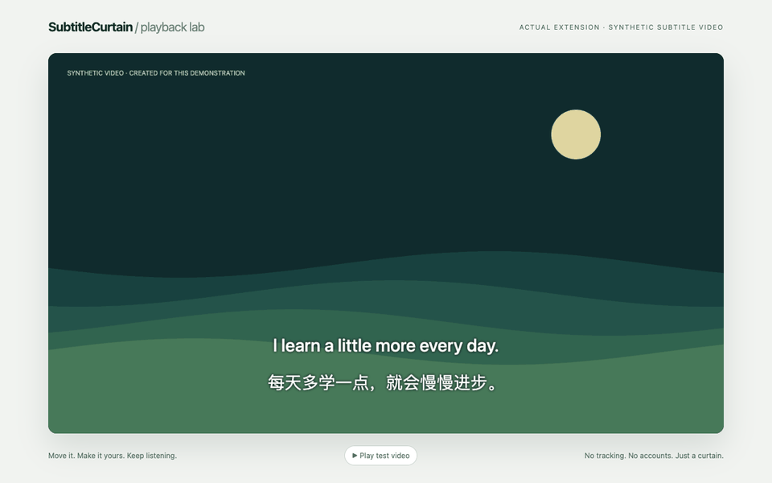
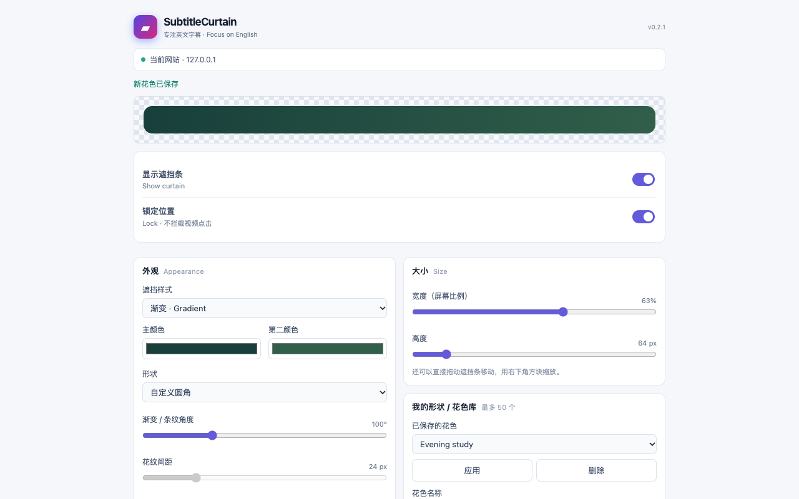

# SubtitleCurtain

**Hide translated subtitles. Keep your attention on the English.**

A free, open-source subtitle hider: drag a customizable curtain over the subtitles you want to stop reading. Your video stays on the webpage; your settings stay on your device.

[Website & installation](https://kimmmmy112.github.io/SubtitleCurtain/) · [中文说明](README.zh-CN.md) · [Free downloads](https://github.com/KIMMMMY112/SubtitleCurtain/releases) · [Report a bug](https://github.com/KIMMMMY112/SubtitleCurtain/issues/new?template=bug.yml)



*Real extension capture on a synthetic video/subtitle test fixture. It shows actual dragging, resizing, appearance changes, lock and hide/restore. It is not a recording of a third-party video website. [Capture details](docs/media/README.md).*

| Chrome | Edge | Brave | Opera | Safari |
| --- | --- | --- | --- | --- |
| [Install from GitHub](docs/INSTALL.md#chrome-edge-brave-opera--free-github-zip) | [Install from GitHub](docs/INSTALL.md#chrome-edge-brave-opera--free-github-zip) | [Install from GitHub](docs/INSTALL.md#chrome-edge-brave-opera--free-github-zip) | [Install from GitHub](docs/INSTALL.md#chrome-edge-brave-opera--free-github-zip) | [Userscripts preview](docs/SAFARI.md) |

Chrome and Edge store listings are **not published yet**. The [Safari userscript preview is published on Greasy Fork](https://greasyfork.org/en/scripts/602877-subtitlecurtain). The Chromium links lead to real GitHub installation instructions. GitHub downloads will remain free and available if listings are added. If this is useful, a **[GitHub star](https://github.com/KIMMMMY112/SubtitleCurtain)** helps other learners find the project. No incentives or star exchanges.

## Features

- Show a curtain on a video webpage and drag it freely to the translated subtitle line.
- Resize width/height with the corner handle or settings; use arrow keys for precise adjustment.
- Solid colors, two-color gradients, four patterns, opacity, rounded corners, built-in shapes and a custom polygon editor.
- Show/hide in one click without losing the setup. Save preferences per website and restore them after refresh.
- Lock the curtain so clicks reach the player beneath it.
- Save, apply, update, rename and delete appearance presets; export/import the library as JSON.
- Supported webpage/player-container fullscreen modes, with explicit limits for direct video-element and native system fullscreen.
- Shared portable core, renderer and settings controller for Chromium MV3 and the Safari userscript.



## Installation

### Chrome, Edge, Brave and Opera

1. Download **`SubtitleCurtain-Chromium-…zip`** from the [latest stable release](https://github.com/KIMMMMY112/SubtitleCurtain/releases/latest), and extract it into a permanent folder.
2. Open your browser's extensions page: `chrome://extensions`, `edge://extensions`, `brave://extensions` or `opera://extensions`.
3. Enable **Developer mode → Load unpacked**. Select the extracted folder directly containing `manifest.json`.
4. Refresh the video page, open SubtitleCurtain from the browser extensions menu and enable **Show curtain**. Position it, resize it, then lock it.

[Full guide with an actual installation screenshot](docs/INSTALL.md). Do not double-click `popup.html`. The **Store** ZIP is an upload package for publishers, not the manual-install download.

### Safari on Mac, iPhone and iPad — preview

Install the free [Userscripts host app](https://apps.apple.com/us/app/userscripts/id1463298887), enable it in Safari, then open the [Greasy Fork script page](https://greasyfork.org/en/scripts/602877-subtitlecurtain) **in Safari**. Choose **Install this script**, then use Extensions → Userscripts to complete installation. Allow access to the installation page and your video website. The [GitHub `.user.js` download](https://raw.githubusercontent.com/KIMMMMY112/SubtitleCurtain/main/userscripts/SubtitleCurtain.user.js) remains a free backup.

If no install prompt appears, use the **Userscripts directory ZIP** from the [Safari preview release](https://github.com/KIMMMMY112/SubtitleCurtain/releases): extract it in Files, then select the folder directly containing `SubtitleCurtain.user.js` in Userscripts → **Set Userscripts Directory**. Existing scripts can share the same selected folder.

**iPhone/iPad device acceptance is pending, and an iPad installation issue has been reported.** The directory fallback is prepared, not recorded as successful on that device. Safari is implemented as a userscript preview; it is not an App Store native SubtitleCurtain extension. [Safari setup, updates and limitations](docs/SAFARI.md).

## Supported Browsers

Compatibility means the specific recorded environment and mode, not every version or website. See [current release status](docs/RELEASE-STATUS.md) and [historical Chromium tests](docs/TEST-REPORT.md).

| Environment | Evidence / scope |
| --- | --- |
| Chrome | Real MV3 extension regression suite; version and current outcome recorded for each release. |
| Edge, Brave, Opera | Shared MV3 package. v0.1.0 has 28 checks per browser on macOS arm64; a newer Chrome pass does not replace a separate test of these browsers. |
| Mac Safari + Userscripts | v0.2.0 preview has actual Safari 18.1 / Userscripts 4.8.6 observations. Later metadata changes and manager updates have separate verification limits. |
| Playwright WebKit | Desktop, phone and tablet viewports with a test GM bridge. This is not physical iPhone/iPad acceptance. |
| iPhone / iPad Safari | Preview targets; physical-device acceptance pending, with an unresolved iPad installation report. |

Webpage/CSS fullscreen and supported player-container Fullscreen API modes are the intended path. Native iOS video fullscreen, picture-in-picture and native apps are outside the webpage and cannot be covered. Direct `<video>` fullscreen may restrict dragging/editing even where the curtain is visible. Restricted browser pages and extension stores cannot run the curtain. No universal website compatibility is claimed.

## Privacy

No analytics, ads, accounts, paid APIs or runtime servers. The curtain does not analyze the video or read subtitle text. It processes and stores **website hostnames, geometry and style preferences locally**; it does not transmit them to the developer. Script managers may separately contact the declared update host. Local processing is still disclosed data processing. [Full privacy policy](PRIVACY.md).

Permissions: `storage` for local preferences; `activeTab` for toolbar interaction; static HTTP/HTTPS content scripts for the overlay and matching iframe players. Restrict site access in browser settings if desired.

## FAQ

**Does it automatically remove or detect subtitles?** You place a visual curtain manually. It does not edit the video, recognize languages or identify subtitle lines.

**Can I keep using the free GitHub version?** Yes. Store listings will be an additional installation channel. Downloads and MIT-licensed source remain here.

**How do updates work?** GitHub Chromium ZIPs require replacing the same installed folder, reloading the extension and refreshing pages. Store installs use the store's updater after publication. Userscript metadata includes update links, but manager/version behavior varies; some Userscripts releases disabled automatic checks. Replace the original script manually if needed, keeping its name/namespace and avoiding duplicate enabled copies.

**Why can't I move the bar?** Unlock it first. Locked areas intentionally pass clicks to the video. `Alt + Shift + S` toggles visibility; `Alt + Shift + L` toggles locking where the browser delivers the shortcuts.

**What if setup fails?** Start with [the illustrated guide](docs/INSTALL.md), then open an issue with browser/OS/version, install method and a safe public reproduction. Never share account details or private tabs.

## Contributing

[Contribution guide](CONTRIBUTING.md) · [Issue templates](https://github.com/KIMMMMY112/SubtitleCurtain/issues/new/choose) · [Release process](docs/distribution/RELEASING.md)

Contributors use Node.js 22.13+; ordinary users do not need developer tools.

```sh
npm ci
npm run check
npm run test:browser
npm run test:webkit
npm run package
npm run package:safari
npm run build:site
npm run check:artifacts
```

The site is static HTML/CSS/JS deployed to GitHub Pages from this repository. The extension and userscript are built from the same core. [Community introduction drafts](docs/distribution/COMMUNITY-COPY.md) describe the actual scope and have not been posted on your behalf.

## License

[MIT](LICENSE) · © 2026 KIMMMMY112. Free to use, modify and share.
