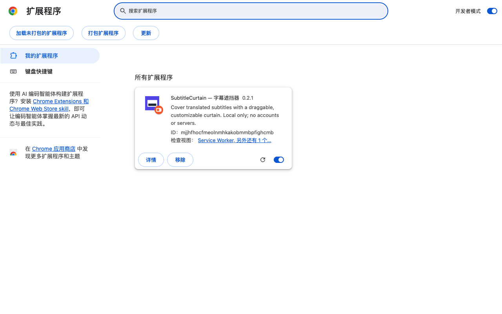

# Install SubtitleCurtain / 安装指南

No coding, Xcode, Node.js or account is needed to use the GitHub downloads. Only store publishers/contributors need developer accounts/tools.

## Chrome, Edge, Brave, Opera — free GitHub ZIP

1. Open [the latest stable release](https://github.com/KIMMMMY112/SubtitleCurtain/releases/latest). Download the file with **Chromium** in its name. Store ZIPs are for publisher dashboards.
2. Extract the ZIP to a permanent folder. Keep it after installation.
3. Open the address for your browser below, turn on **Developer mode**, then choose **Load unpacked**. Select the extracted folder directly containing `manifest.json`.
4. Open a normal HTTP/HTTPS video webpage and refresh it. Open SubtitleCurtain from the browser extensions menu, then turn on **Show curtain**. Drag the bar to the translated subtitles, resize it, then lock it.

| Browser | Type this in its address bar |
| --- | --- |
| Chrome | `chrome://extensions` |
| Edge | `edge://extensions` |
| Brave | `brave://extensions` |
| Opera | `opera://extensions` |

The screenshot is Chrome; Edge, Brave and Opera have their own labels. Developer-mode warnings are normal. Do not open `popup.html` as a standalone file. Browser-internal pages and app/PiP windows cannot run the curtain.

**Upgrade:** export your style library as a backup, extract the new Chromium ZIP over the same installed folder, choose Reload on the extension-management page, then refresh the video page. Removing and reinstalling can erase local settings. GitHub ZIP installations do not update automatically. Store installs update through the relevant store once a listing exists; no listing link is advertised before publication.

## Safari — free Userscripts preview

See [Safari installation](SAFARI.md). Install the free Userscripts host app, then install the `.user.js` script in Safari. If the install prompt is absent, use the directory ZIP fallback. The iPad installation issue is still recorded as unresolved until there is actual device evidence. Greasy Fork submission materials are prepared; a live listing will be linked only after publication.

No authentic iPad installation screenshot is available yet; we do not substitute a desktop mockup. The Userscripts app chooses a folder; its Safari extension handles script lists and installation. Existing Mac installation does not automatically install the script on iPad/iPhone.

## 使用说明（中文）

Chromium 浏览器：在稳定版 Release 下载名称带 **Chromium** 的 ZIP，解压到固定文件夹。打开上表对应的扩展管理地址，开启开发者模式 → 加载已解压的扩展程序 → 选择直接含 `manifest.json` 的文件夹。刷新视频网页，从扩展菜单打开 SubtitleCurtain，开启显示，拖动/调整后锁定。不要直接打开 `popup.html`。更新时覆盖同一目录并重新加载；先导出花色备份，卸载可能清除数据。

Safari：先安装免费的 Userscripts，再在 Safari 安装脚本；没有安装提示时，下载 Userscripts ZIP，在“文件”App 解压，用 Userscripts App 的 Set Userscripts Directory 选择直接包含 `SubtitleCurtain.user.js` 的文件夹。已有其他脚本时，将该文件放入当前目录。回到 Safari 授予视频网站访问权限、启用脚本并刷新。

## Troubleshooting

- **No bar:** refresh the video page, allow site access, enable Show curtain. On Safari also enable script injection and the script itself.
- **Cannot drag:** unlock it. Locked areas intentionally pass clicks to the video.
- **No Safari install prompt:** use Safari rather than an in-app browser; check permission for the installation page as well as the video site; use the directory fallback if needed.
- **Controls missing after rotation:** reopen settings and adjust in the current viewport. Mobile-device behavior remains subject to device testing.
- **Native fullscreen/PiP:** webpage overlays cannot cover iOS system video fullscreen, picture-in-picture or native apps. Use inline or website fullscreen. Container Fullscreen API behavior is recorded separately from direct video-element fullscreen.
- **Still stuck:** [report a bug](https://github.com/KIMMMMY112/SubtitleCurtain/issues/new?template=bug.yml) with version, browser, OS, installation method and public-page reproduction steps.
